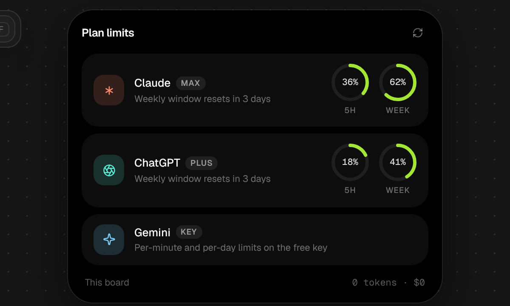

<div align="center">


# Sinnect

**An infinite canvas for your AI coding sessions.**

Run Claude, ChatGPT and Gemini sessions side by side, watch them work live,<br />
and wire them together so they share what they're doing.

<a href="https://github.com/Suma-Udd/Sinnect/releases/latest/download/Sinnect-Setup.exe"></a>
&nbsp;
<a href="https://github.com/Suma-Udd/Sinnect/releases/latest/download/Sinnect-mac-arm64.dmg"></a>
&nbsp;
<a href="https://github.com/Suma-Udd/Sinnect/releases/latest/download/Sinnect-mac-intel.dmg"></a>

[](https://github.com/Suma-Udd/Sinnect/releases/latest)
[](https://github.com/Suma-Udd/Sinnect/releases)
[](https://github.com/Suma-Udd/Sinnect/actions/workflows/ci.yml)
[](LICENSE)

<br />


</div>

<br />

## What you get

<table>
  <tr>
    <td width="34%">🗺️ <b>A canvas, like n8n</b></td>
    <td>Pan, zoom, and drop as many sessions as you want. Group them into colored families.</td>
  </tr>
  <tr>
    <td width="34%">👀 <b>Watch them live</b></td>
    <td>Every card shows what it's doing right now and what it costs. Double-click to open the full conversation.</td>
  </tr>
  <tr>
    <td width="34%">🔌 <b>Wire them together</b></td>
    <td>Drag a line between two cards and those sessions can message each other.</td>
  </tr>
  <tr>
    <td width="34%">🤝 <b>No file fights</b></td>
    <td>Sessions claim a file before editing it. Higher priority wins, ties get negotiated, and if they still can't agree, you decide.</td>
  </tr>
  <tr>
    <td width="34%">🧠 <b>Memory that learns</b></td>
    <td>Sessions write down short lessons and skills as markdown, so the next one starts smarter. Works with Obsidian.</td>
  </tr>
  <tr>
    <td width="34%">🧑‍🔧 <b>Helpers</b></td>
    <td>A session can send side jobs to cheaper helper sessions that run in parallel and report back.</td>
  </tr>
  <tr>
    <td width="34%">💸 <b>Token-cheap</b></td>
    <td>The coordination runs in plain code and costs zero tokens. Sessions only ever see short summaries of each other.</td>
  </tr>
</table>

<table>
  <tr>
    <td width="33%"></td>
    <td width="33%"></td>
    <td width="33%"></td>
  </tr>
  <tr>
    <td align="center"><sub>Open a session to see everything</sub></td>
    <td align="center"><sub>Questions drop in from the top</sub></td>
    <td align="center"><sub>Keep an eye on your plan limits</sub></td>
  </tr>
</table>

## Get started

1. **Download** the installer above and open it. If Windows says "Windows protected your PC", click **More info** then **Run anyway** (the app isn't code-signed yet).
2. **Sign in** with your Claude account, or paste an API key. You can add ChatGPT or Gemini later in Settings.
3. **Press `Tab`** (or right-click the canvas) to start a session. Drag from one card to another to connect them.

That's it. Sinnect updates itself from inside the app.

> On a Mac? The Mac build is a fresh beta and needs one extra click to open the first time. See the [Mac steps](docs/install.md#mac-beta).

## Try it for free

Demo mode runs fake sessions in your browser so you can play with the canvas without spending anything:

```bash
npm install && npm run demo   # then open http://127.0.0.1:4317
```

## Learn more

- 📦 [Install and sign in](docs/install.md): Windows, Mac, Claude, ChatGPT and Gemini
- ✨ [All features](docs/features.md): everything Sinnect can do, in detail
- 🛠️ [Development](docs/development.md): build it yourself, how it's made, how releases work
- 🤖 [AGENTS.md](AGENTS.md): the full brief for AI coding agents working on this repo

## License

[MIT](LICENSE). Not affiliated with Anthropic, OpenAI or Google.
