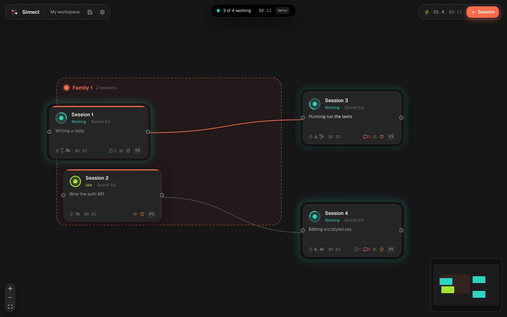
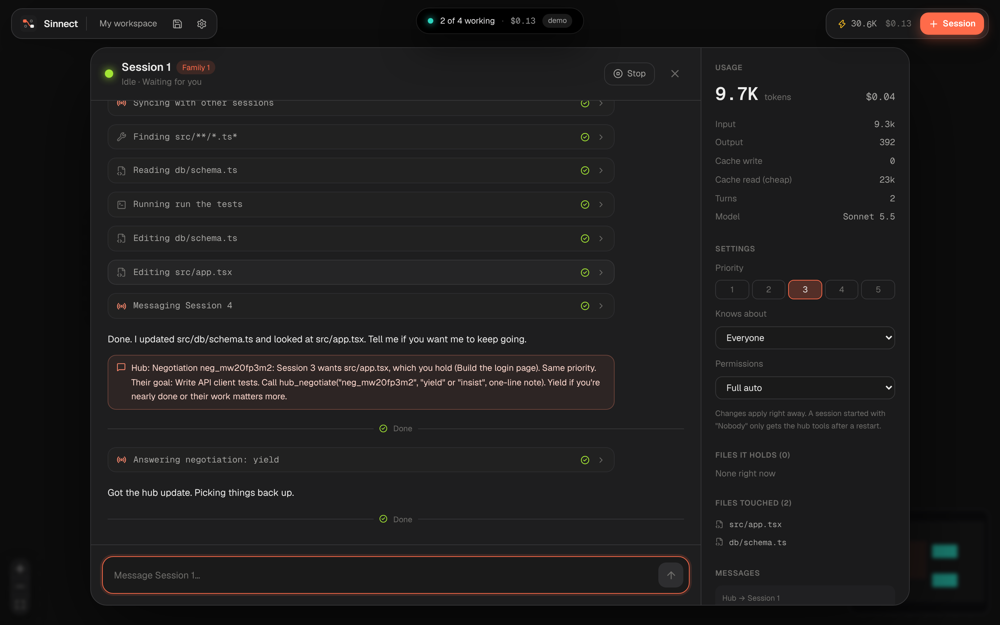
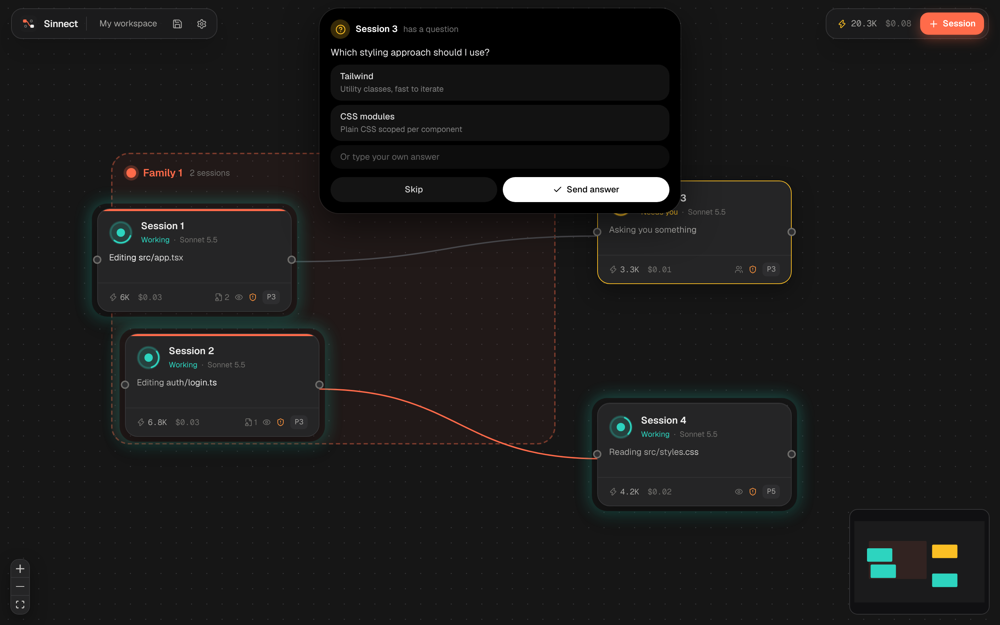

# Sinnect

_From σύνδεση (Greek for "connection") and connect._

An infinite canvas for Claude sessions. Spawn as many as you want, watch them work live, wire them together so they share what they're doing, group them into families, and let them sort out who edits which file without stepping on each other.

Think n8n's canvas, but every node is a Claude session.



## Download

**[⬇ Download Sinnect for Windows](https://github.com/Suma-Udd/Sinnect/releases/latest/download/Sinnect-Setup.exe)**

1. Open `Sinnect-Setup.exe` and click through the installer. No Node, no terminal, nothing else to install.
2. Windows might say "Windows protected your PC" because the app isn't code-signed yet. Click **More info**, then **Run anyway**.
3. Open Sinnect from the Start menu, click **Sign in with Claude**, follow the steps in the window that pops up, and you're in. Prefer paying per token? Pick **Use an API key** instead.

Mac and Linux builds aren't out yet.

## What it does

- **Canvas:** pan, zoom, box-select, minimap. Right-click or press `Tab` to spawn a session.
- **Live cards:** each session shows what it's doing right now and how many tokens it used. Double-click to morph it open into the full conversation, tool calls, files and messages.
- **Families:** colored frames for sessions working on the same topic. Drag a card in or out to change membership.
- **Connections:** drag from one card to another. Connected sessions can message each other, and you see a light travel along the line when they do.
- **File coordination:** every edit claims the file first. Higher priority wins on its own. Equal priority sessions negotiate (yield or insist, max 2 rounds) and if they can't agree, you decide.
- **Dynamic island:** permission requests and questions drop down from the top of the window.
- **Workspaces:** save and load whole boards. Autosaves every few seconds. Saved sessions come back with a Resume button.





## Token-cheap by design

The coordination layer (the Hub) runs in plain code inside the app and costs zero tokens. Sessions never see each other's transcripts. They get one-line summaries, short capped messages, and a notice only when something actually concerns them (a file they want, a message sent to them). Status lines on cards are built from tool calls, not from asking Claude to summarise.

## Signing in

Two modes, set in Settings:

- **My Claude account:** click **Sign in with Claude** on first launch. Sessions run through Claude Code's own login on your PC and usage comes out of your Claude plan. Anthropic's Agent SDK docs don't allow third-party apps to offer claude.ai login, so treat this mode as personal use at your own risk.
- **API key:** pay per token with a key from console.anthropic.com. This is the officially supported way.

## Try it without spending anything

Demo mode simulates sessions (streaming, tool calls, conflicts, questions) for free:

```bash
npm install
npm run demo
# open http://127.0.0.1:4317
```

## Build it yourself (developers)

Needs Node 20+, Rust, and the [Tauri prerequisites](https://tauri.app/start/prerequisites/).

```bash
npm install
npm run app:dev      # development window
npm run app:build    # installer in src-tauri/target/release/bundle/nsis
```

Or skip all that: the **Windows build** GitHub Action builds the installer for you (Actions tab, "Run workflow"), and attaches it to a release when you push a `v*` tag.

## How it's built

| Part | What | Where |
| --- | --- | --- |
| Shell | Tauri 2 (Rust). Opens the window and starts the engine. | `src-tauri/` |
| Engine | Node process. Runs sessions with the Claude Agent SDK, hosts the Hub, talks to the UI over a local WebSocket. | `packages/engine/` |
| UI | React + React Flow + Motion + Tailwind. | `packages/ui/` |

Useful scripts: `npm test` (Hub tests), `npm run typecheck`, `npm run dev:mock` + `npm run dev:ui` for UI work with hot reload.

## License

MIT. Not affiliated with Anthropic. Powered by Claude.
